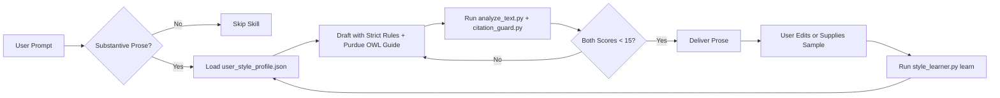

# Architecture — Human Writing Guard

## Design Goals

1. **Zero dependencies:** All scripts (`analyze_text.py`, `style_learner.py`, and `citation_guard.py`) run on Python 3.10+ using only the standard library so any agent environment can execute them immediately.
2. **Scoped activation:** Prose constraints only trigger on substantive writing tasks (academic papers, assignments, project descriptions, technical documentation, formal reviews, and emails) so normal coding and Q&A stay fast.
3. **Closed-loop verification:** Agents do not guess whether a draft sounds human or cites sources properly; they run `analyze_text.py` (`risk_score < 15`) and `citation_guard.py check` (`citation_risk_score < 15`) before delivering prose.
4. **Privacy-preserving learning:** `style_learner.py` stores statistical metrics (sentence length mean/std, contraction rate, punctuation ratios, transition frequencies) in `references/user_style_profile.json` rather than storing raw personal documents.

## Pipeline

## Scoring Model (`analyze_text.py`)

| Signal Category | Max Weight | What It Catches |
|---|---:|---|
| AI vocabulary by era | 30 | Overrepresented 2023–2026 LLM words and Grok-isms |
| Significance & legacy puffery | 20 | `serves as`, `pivotal moment`, `broader movement`, `shaped discussions` |
| Negative parallelisms | 20 | `not just X, but also Y`, `not X, but Y`, `Y rather than X` |
| Hedging & corrective disclaimers | 20 | `important to note`, `not widely documented`, `should be treated as... rather than` |
| Formulaic endings | 20 | `Despite these challenges`, `continues to thrive`, `In summary/conclusion` |
| Superficial `-ing` clauses | 20 | Trailing `, highlighting...`, `, reflecting...`, `, fostering...` |
| Copulative avoidance | 20 | `serves as`, `boasts`, `features`, `offers` replacing `is`/`are`/`has` |
| Leaked assistant artifacts | 20 | `Certainly!`, `utm_source=`, `oaicite`, date/URL placeholders |
| Low sentence burstiness | 12 | Uniform sentence length (`std_dev < 4.5` or `>85%` in 8–20 word band) |
| Style & punctuation tells | 21 | Inline-bold bullet lists, spaced em-dash spam (` — `), curly quotes |

## Citation & Research Model (`citation_guard.py`)

Modeled on the [Purdue OWL Research and Citation Resources](https://owl.purdue.edu/owl/research_and_citation/index.html):

- **`styles`:** Lists the 7 supported styles (`apa`, `mla`, `chicago-nb`, `chicago-ad`, `ieee`, `ama`, `asa`), their fields, in-text formats, and block-quote word thresholds.
- **`format`:** Generates reference-list entries, parenthetical in-text citations, and narrative citations for journal articles, books, and web sources.
- **`check`:** Audits drafts for placeholder citations, uncited direct quotes, long inline quotes needing block-quote formatting, unsupported statistics, mixed citation systems, style/heading/alphabetical-order mismatches, orphan in-text citations, uncited reference entries, and (with `--source`) unquoted 6-gram overlap / patchwriting.
